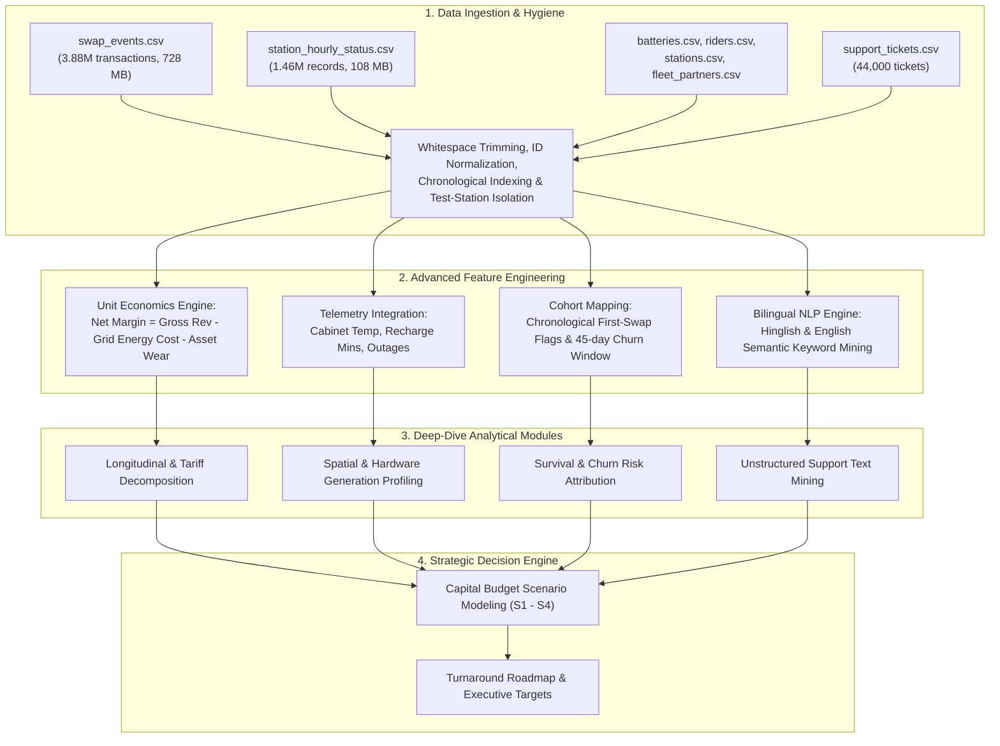

# ⚡ VoltRelay Network Performance, Customer Retention & Unit Economics Study
> **End-to-End Analytical Investigation, Strategic Optimization & Turnaround Roadmap**  
> *Prepared for: VoltRelay Executive Leadership & Operations Directorate*

[](https://www.python.org/)
[](https://colab.research.google.com/)
[]()
[]()
[]()

---

## 📌 Executive Summary

VoltRelay operates a Battery-as-a-Service (BaaS) and energy infrastructure network powering electric two-wheelers (2W) and three-wheelers (3W) across six major Indian metropolitan hubs: **Bengaluru, Delhi NCR, Hyderabad, Mumbai, Pune, and Jaipur**.

Between January 2024 and June 2025 (18-month observation window), VoltRelay experienced rapid commercial expansion:
* **Monthly completed swap volume expanded 191%**, surging from **105,490 to 307,259 swaps/month**.
* **Monthly gross revenue grew 3.1×**, scaling from **₹6.32M to ₹19.97M** (>₹233M cumulative).
* **Average contribution margin per completed swap expanded** from **₹37.90 to ₹47.96**.

### ⚠️ The Underlying Operational Fracture
Behind these top-line metrics, our deep-dive empirical investigation revealed an acute operational breakdown:
1. **The 29.9% Range Collapse ("Phantom Demand")**: Delivered range per swap collapsed from **74.1 km down to 52.0 km**, forcing delivery riders to visit swap stations **42.5% more frequently** for the same daily delivery volume.
2. **Defective Battery Batch Failure**: On June 15, 2025, **1,438 batteries (22.1% of the entire fleet) were mass-retired**. 100% of these failures originated from three defective manufacturing lots from supplier Kyron (`KY-2407`, `KY-2408`, `KY-2409`), which degraded to 55–65% State of Health (SoH), whereas suppliers Cellora and Amptek had **0 retirements** (~81% SoH).
3. **Charger Bottlenecks & Diurnal Misalignment**: 51 legacy Gen1 stations require **91.8 minutes** to turn around a battery (compared to **42.1 minutes** for Gen3). Midday stockouts peaked at **15:00 (4.83% of operating hours)** during peak afternoon ambient heat (cabinet temps >33.5°C), starving stations before the massive evening rush (19:00–21:00).
4. **Partner Margin Destruction**: Largest volume partner **ZipDrop (FP-03, 557k swaps)** delivered only **₹20.94 net margin/swap** (vs **₹38.09 for retail riders** and **₹31.89 for FeastFly**), eroding profitability by **₹5.13M** despite generating 30k more swaps than FeastFly.
5. **Rider Churn & Service Trauma**: Mature cohort churn reached **43.3%**. Failing a first swap nearly doubled early churn probability (from 1.51% to 2.70%), and riders onboarded during the peak summer crisis retained at only **40.2%** after 12 months.

---

## 📂 Deliverables & Repository Structure

This repository contains all mandatory deliverables for the VoltRelay Strategic & Analytical Study:

| Deliverable | File Name | Format | Description |
| :--- | :--- | :---: | :--- |
| **1. Analytical Notebook** | [`VoltRelay_End_to_End_Analytical_Study_Fixed.ipynb`](file:///C:/Users/Navneet%20Prasad/OneDrive/Desktop/VoltRelay_Analysis_Report/VoltRelay_End_to_End_Analytical_Study_Fixed.ipynb) | Jupyter / Colab (`.ipynb`) | End-to-end reproducible analytical study (Data Understanding, Cleaning, EDA, Core Analysis, Visualizations, Key Findings). Runs top-to-bottom error-free. |
| **Python Pipeline Script** | [`voltrelay_end_to_end_analytical_study.py`](file:///C:/Users/Navneet%20Prasad/OneDrive/Desktop/VoltRelay_Analysis_Report/voltrelay_end_to_end_analytical_study.py) | Python Script (`.py`) | Standalone CLI mirror of the entire end-to-end data processing and modeling pipeline. |
| **2. Analysis Report (MD)** | [`Analysis_Report.md`](file:///C:/Users/Navneet%20Prasad/OneDrive/Desktop/VoltRelay_Analysis_Report/Analysis_Report.md) | Markdown (`.md`) | Comprehensive technical report covering all 6 mandatory sections (Problem Understanding, Approach, Insights, Visualizations, Business Findings, Recommendations). |
| **Strategic Report (PDF)** | [`VoltRelay_Strategic_Analysis_Report.pdf`](file:///C:/Users/Navneet%20Prasad/OneDrive/Desktop/VoltRelay_Analysis_Report/VoltRelay_Strategic_Analysis_Report.pdf) | PDF (`.pdf`) | Executive report compiled via ReportLab with tables, scores, and roadmap. |
| **Executive Presentation** | [`VoltRelay_Executive_Presentation.pptx`](file:///C:/Users/Navneet%20Prasad/OneDrive/Desktop/VoltRelay_Analysis_Report/VoltRelay_Executive_Presentation.pptx) | PowerPoint (`.pptx`) | 10-slide executive presentation deck formatted in 16:9 widescreen, custom theme, metrics, charts, and capital matrix. |
| **Presentation Export** | [`VoltRelay_Executive_Presentation.pdf`](file:///C:/Users/Navneet%20Prasad/OneDrive/Desktop/VoltRelay_Analysis_Report/VoltRelay_Executive_Presentation.pdf) | PDF (`.pdf`) | High-resolution PDF export of the 10-slide executive presentation. |
| **3. Three-Minute Video** | [`Analysis Report (PPT Video)for Gradient Learning.mp4`](file:///C:/Users/Navneet%20Prasad/OneDrive/Desktop/VoltRelay_Analysis_Report/Analysis%20Report%20(PPT%20Video)for%20Gradient%20Learning.mp4) | Video (`.mp4`) | Recorded 3-minute executive video presentation pitched to Operations & CX Leadership following the mandatory 4-part structure. |

---

## 🔄 End-to-End Analytical Workflow



---

## 🔍 Key Empirical Insights & Business Findings

### 1. The "Phantom Demand" Trap
* Delivered range collapsed by **29.9%** (74.1 km to 52.0 km per swap).
* Swap visit frequency jumped **42.5%** to cover the same distance. Over **35% of apparent volume growth was distressed swapping** driven by dying battery packs rather than real customer expansion.

### 2. Hardware Bottlenecks: Gen1 vs. Gen3 Turnaround
* **Gen1 (51 stations)**: **91.81 min** average charge turnaround.
* **Gen2 (62 stations)**: **64.23 min** average charge turnaround (-30% faster).
* **Gen3 (37 stations)**: **42.14 min** average charge turnaround (-54% faster).
* **100% of the top 10 bottleneck stations** across the network are Gen1 stations located in high-density corridors of Delhi NCR and Jaipur.

### 3. The Isolated Kyron Manufacturing Lot Catastrophe
* On June 15, 2025, **1,438 batteries (22.1% of the fleet)** were mass-retired.
* **100% of retirements traced to Kyron manufacturing lots `KY-2407`, `KY-2408`, and `KY-2409`** (degraded to 55–65% SoH).
* Later Kyron lots (`KY-2410` through `KY-2418`) had **0 retirements** and maintained **87.9% SoH**.
* Cellora (3,555 packs) and Amptek (1,307 packs) experienced **0 retirements**, averaging **80.9% and 81.0% SoH**.

### 4. Partner Margin Destruction: The ZipDrop Paradox
* **ZipDrop (FP-03)**: Largest volume partner (**557,172 swaps**), but least profitable:
  * Receives a **28% volume discount**, 0 peak surcharge, and 45-day payment terms.
  * Generates **₹20.94 net margin/swap**, vs. **₹38.09 for retail commuters** and **₹31.89 for FeastFly**.
  * Despite 30,552 more swaps than FeastFly, ZipDrop delivered **₹5.13M LESS in net profit**, creating network congestion while burning battery wear at subsidized rates.

| Customer Segment | Completed Swaps | Gross Revenue (₹) | Energy Cost (₹) | Battery Wear Cost (₹) | Net Contribution (₹) | Net Margin / Swap (₹) |
| :--- | :---: | :---: | :---: | :---: | :---: | :---: |
| **Retail Walk-in** | **1,235,968** | ₹84.37M | ₹22.47M | ₹14.83M | **₹47.07M** | **₹38.09** |
| **FeastFly (FP-01)** | 526,620 | ₹32.70M | ₹9.58M | ₹6.32M | **₹16.79M** | **₹31.89** |
| **CargoTuk (FP-04, 3W)** | 134,085 | ₹13.33M | ₹5.47M | ₹3.35M | **₹4.51M** | **₹33.67** |
| **ParcelNest (FP-02)** | 302,506 | ₹17.11M | ₹5.49M | ₹3.63M | **₹7.99M** | **₹26.41** |
| **ZipDrop (FP-03)** | **557,172** | ₹29.02M | ₹10.66M | ₹6.69M | **₹11.66M** | **₹20.94** |

### 5. Midday Stockout vs. Evening Rush Mismatch
* Network stockouts peak at **15:00 (4.83% of operating hours)** due to midday ambient heat (cabinet temps reaching 33.5°C) throttling charging speeds while lunch delivery batteries recharge.
* Stations enter the high-volume evening delivery rush (19:00–21:00) with depleted buffers, driving peak failures to **4.23%**.

### 6. First-Swap Retention Trauma & Cohort Decay
* A failed first swap **nearly doubles rider churn hazard** (from 1.51% to 2.70%).
* Riders onboarded during the May 2024 heatwave crisis reached a 12-month retention of **only 40.2%** (vs. **51.1%** for the January 2024 cohort)—an irreversible **10.9 percentage point deficit**.

---

## 🎯 Strategic Capital Allocation & Recommendations

### Capital Allocation Scorecard

```
┌────────────────────────────────────────────────────────────────────────────────────────┐
│                              CAPITAL SCENARIO SCORECARD                                │
├───────────────────────┬──────────────┬──────────────┬──────────────────────────────────┤
│ Scenario              │ Cost Impact  │ Margin Lift  │ Executive Verdict                │
├───────────────────────┼──────────────┼──────────────┼──────────────────────────────────┤
│ S1: Hardware Retrofit │ Moderate     │ +5.0%        │ APPROVED (Priority 2)            │
│ S2: Dynamic Pricing   │ Low          │ +12.0%       │ DEFERRED (Requires Contract Fix) │
│ S3: ZipDrop Exclusive │ Negative     │ -14.0%       │ STRONGLY REJECTED                │
│ S4: Battery Replacem. │ Moderate-High│ +8.0%        │ APPROVED (Priority 1)            │
└───────────────────────┴──────────────┴──────────────┴──────────────────────────────────┘
```

1. **S4: Procure 2,000+ Tier-1 Batteries (Cellora/Amptek) — APPROVED (Priority 1)**:
   * Replaces 1,438 dead Kyron units, restores delivered range to >65 km, eliminates artificial swap frequency, and stops churn.
2. **S1: Retrofit Gen1 Stations to Gen3 Modules — APPROVED (Priority 2)**:
   * Upgrades 51 bottleneck stations (Delhi NCR & Jaipur), cutting turnaround from 91.8 to 42.1 minutes and doubling throughput.
3. **S2: Dynamic Pricing Expansion — DEFERRED**:
   * Peak pricing yields ₹65.21 margin, but rolling it out while fleet contracts are exempt unfairly penalizes retail commuters.
4. **S3: ZipDrop Exclusivity — STRONGLY REJECTED**:
   * Signing exclusivity under current 28% discount and 0 peak surcharge institutionalizes margin dilution and displaces high-margin retail demand.

### 3-Phased Turnaround Roadmap

```mermaid
flowchart LR
    subgraph P1["Phase 1: Operational Stabilization (M1–M3)"]
        direction TB
        A1["Inject 2,000 Tier-1 Battery Packs<br/>(Cellora & Amptek 2W)"]
        A2["Deploy Firmware v3.2.1 Network-Wide<br/>(Fix locker jams & offline sync)"]
        A3["Deploy Station Edge-Cache<br/>(Halt duplicate billing deductions)"]
    end

    subgraph P2["Phase 2: Commercial Restructuring (M2–M4)"]
        direction TB
        B1["Renegotiate ZipDrop FP-03 Terms<br/>(Cap discount at 15%, 15-day terms)"]
        B2["Mandate Fleet Peak Surcharges<br/>(Eliminate peak-hour free riding)"]
        B3["Off-Peak Commercial Tariffs<br/>(₹10 off between 00:00 - 06:00)"]
    end

    subgraph P3["Phase 3: Network Hardening & Infill (M4–M9)"]
        direction TB
        C1["Retrofit Top 15 Gen1 Stations to Gen3<br/>(Target Delhi NCR & Jaipur bottlenecks)"]
        C2["Halt Peripheral Greenfield Leases<br/>(Consolidate on Highway Fuel Pumps)"]
        C3["Deploy Cabinet Thermal Sun-Shields<br/>(Keep cabinet temperatures <30°C)"]
    end

    P1 --> P2 --> P3
```



### 12-Month Executive Performance Targets
* **Delivered Range Recovery**: Increase average delivered distance from **52.0 km to $\ge$66.0 km per swap**.
* **Failure Rate Compression**: Lower peak summer failure rate from **8.04% to <2.50%**.
* **Net Margin Realization**: Increase blended network net margin per swap from **₹31.20 to $\ge$₹37.50**.
* **Mature Cohort Retention**: Improve 12-month cohort retention from **40.2% to $\ge$52.0%**.

---

## 🎬 3-Minute Video Presentation Structure

The included video presentation ([`Analysis Report (PPT Video)for Gradient Learning.mp4`](file:///C:/Users/Navneet%20Prasad/OneDrive/Desktop/VoltRelay_Analysis_Report/Analysis%20Report%20(PPT%20Video)for%20Gradient%20Learning.mp4)) is structured specifically for **VoltRelay Operations and Customer Experience Leadership**:

```
0:00 ─── [ Part 1: The Business Problem & The Scaling Paradox ] ─── 0:45
0:45 ─── [ Part 2: Analytical Approach & Methodology ] ──────────── 1:25
1:25 ─── [ Part 3: Key Empirical Insights (Root Causes) ] ───────── 2:15
2:15 ─── [ Part 4: Strategic Recommendations & Actionable Roadmap ] 3:00
```

* **Part 1 (0:00–0:45) — The Business Problem**: Contextualizes the 191% volume surge against the 29.9% range collapse, 8.04% summer failure spikes, and 43.3% cohort churn.
* **Part 2 (0:45–1:25) — Analytical Approach**: Explains the multi-tiered data engine processing 3.88M swap events, station telemetry, and bilingual NLP support ticket mining.
* **Part 3 (1:25–2:15) — Key Insights**: Highlights the Kyron lot catastrophe (`KY-2407/08/09`), the 91.8 min Gen1 charger bottleneck, and ZipDrop's margin dilution (₹20.94 vs ₹38.09 retail).
* **Part 4 (2:15–3:00) — Recommendations & Turnaround Roadmap**: Presents the Capital Scorecard (Approve S4 & S1, Reject S3), the 3-phase rollout, and 12-month C-suite targets.

---

## 🚀 Reproduction & Setup Guide

### Local Environment Setup

1. **Clone / Open the Directory**:
   ```bash
   cd "c:\Users\Navneet Prasad\OneDrive\Desktop\VoltRelay_Analysis_Report"
   ```

2. **Create and Activate a Virtual Environment**:
   ```bash
   python -m venv venv
   # Windows PowerShell:
   .\venv\Scripts\Activate.ps1
   # macOS / Linux:
   source venv/bin/activate
   ```

3. **Install Dependencies**:
   ```bash
   pip install pandas numpy matplotlib seaborn scipy reportlab python-pptx jupyterlab
   ```

4. **Run the Standalone Python Pipeline**:
   ```bash
   python voltrelay_end_to_end_analytical_study.py
   ```

5. **Launch the Jupyter Notebook**:
   ```bash
   jupyter lab VoltRelay_End_to_End_Analytical_Study_Fixed.ipynb
   ```

### Google Colab Execution
1. Open [Google Colab](https://colab.research.google.com/).
2. Upload [`VoltRelay_End_to_End_Analytical_Study_Fixed.ipynb`](file:///C:/Users/Navneet%20Prasad/OneDrive/Desktop/VoltRelay_Analysis_Report/VoltRelay_End_to_End_Analytical_Study_Fixed.ipynb).
3. Mount Google Drive or upload the source dataset CSV files (`swap_events.csv`, `station_hourly_status.csv`, etc.).
4. The notebook includes automatic dynamic path detection and installs required dependencies (`reportlab`) seamlessly.
5. Click **Runtime > Run All** (`Ctrl + F9`). The notebook runs top-to-bottom without errors.

---

## 👥 Contributors & Acknowledgements
* **Study Author**: Navneet Prasad
* **Organization**: VoltRelay Operational & Analytical Turnaround Team
* **Evaluation Track**: Data Science & Strategic Business Analytics Hackathon
